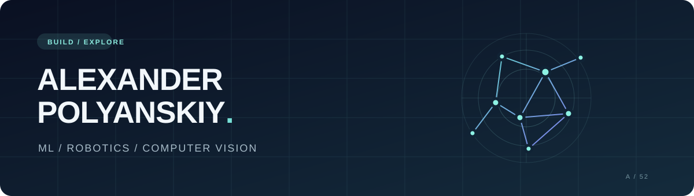
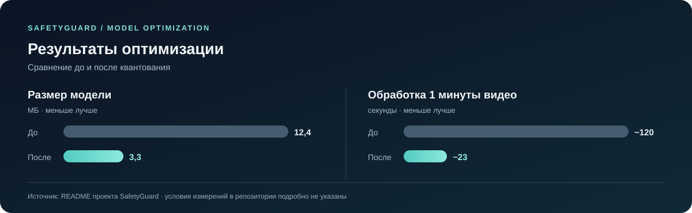

 

**Привет, я Александр.** Работаю с машинным обучением, компьютерным зрением и робототехникой.  
Изучаю модели, собираю прототипы и создаю инструменты для реальных задач.

 

## ◈ &nbsp; Последние проекты

<table>
<tr>
<td width="50%" valign="top">

### 🤖 &nbsp; [Robot-intelect](https://github.com/Alexsandr52/Robot-intelect)

Проект манипуляции для Unitree G1: захват и подъем коробки в симуляции, с планами переноса на реального робота.

`Robotics` `Isaac Lab` `Python`

</td>
<td width="50%" valign="top">

### 👁 &nbsp; [Face Blur](https://github.com/Alexsandr52/face-blur)

Локальная обработка видео: обнаружение и размытие лиц, сравнение подходов YuNet, PyTorch и YOLO.

`Computer Vision` `OpenCV` `YOLO`

</td>
</tr>
<tr>
<td width="50%" valign="top">

### 📚 &nbsp; [KubSU Study Search](https://github.com/Alexsandr52/kubsu-study-search)

Поиск по учебным материалам и сообщениям Telegram: Qdrant, reranker и локальная Qwen для ответов со ссылками на источники.

`RAG` `Qdrant` `LLM`

</td>
<td width="50%" valign="top">

### ✉️ &nbsp; [Gmail Job Classifier](https://github.com/Alexsandr52/gmail-job-classifier)

Классификация писем о вакансиях с помощью локальной модели Ollama: приглашения, ожидание, отказы и другие сообщения.

`Python` `Ollama` `NLP`

</td>
</tr>
</table>

Также в профиле: [Unitree Sim Isaac Lab](https://github.com/Alexsandr52/unitree_sim_isaaclab), форк среды симуляции Unitree Robotics.

 

## ◈ &nbsp; Результаты проекта

 

## ◈ &nbsp; Направления и инструменты

**AI / ML** &nbsp; Python · PyTorch · YOLO · LLM · RAG  
**Разработка** &nbsp; FastAPI · Flask · PostgreSQL · Docker  
**Робототехника** &nbsp; Unitree G1 · Isaac Lab · симуляция

 

ЭКСПЕРИМЕНТЫ &nbsp; / &nbsp; КОД &nbsp; / &nbsp; ПРАКТИКА

